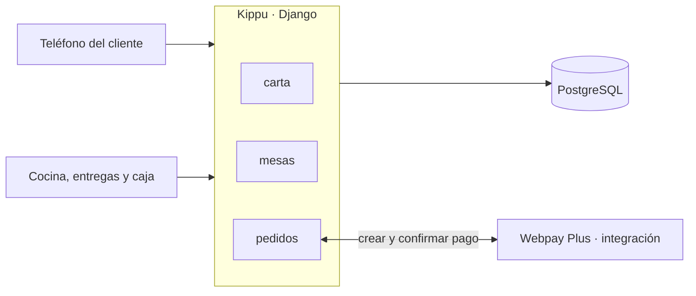

# Kippu

Sistema de autopedido y pago por QR para restaurantes.

## Descripción

Kippu es una aplicación web responsive. El cliente escanea el QR de su mesa, arma su pedido y lo paga
desde su teléfono, con Webpay Plus (ambiente de integración) o en caja. El pedido entra a cocina solo
cuando el pago está confirmado. Está pensado para restaurantes independientes con servicio de mesa y
carta acotada. Caso de estudio simulado: **La Casa Causa**, restaurante peruano de 16 mesas.

El personal usa tres pantallas: cocina, entregas y caja (cobro presencial y cierre de mesas). Locales,
mesas, carta y códigos QR se administran desde `/admin/`.

## Tecnologías

| Capa | Tecnología |
|---|---|
| Lenguaje | Python 3.14 |
| Framework | Django 5.2.17 |
| Base de datos | PostgreSQL 17 (driver `psycopg` 3.3.5) |
| Interactividad | HTMX 2.0.11 y Alpine.js 3.14.9, servidos desde `static/js/vendor/` |
| Pagos | Webpay Plus con `transbank-sdk` 6.1.0, solo en ambiente de integración |
| Otros | `qrcode` 8.2, Pillow 12.3.0, `python-dotenv` 1.2.3 |

No hay servicio en la nube: la demostración corre en una red local.

## Ejecutar localmente (Windows y PowerShell)

Requisitos: Python 3.14 y PostgreSQL con una base vacía y un usuario que pueda crear bases (las
pruebas crean una base temporal).

```powershell
python -m venv .venv
.\.venv\Scripts\python.exe -m pip install -r requirements.txt
Copy-Item .env.example .env
```

Completar `.env`:

| Variable | Valor |
|---|---|
| `DB_NAME`, `DB_USER`, `DB_PASSWORD`, `DB_HOST`, `DB_PORT` | Conexión a PostgreSQL |
| `DJANGO_SECRET_KEY` | Una clave larga y aleatoria |
| `PUBLIC_BASE_URL` | Dirección con la que se arma el QR, por ejemplo `http://127.0.0.1:8000` |
| `DJANGO_ALLOWED_HOSTS` | Hosts aceptados, separados por comas (vacío: `127.0.0.1,localhost`) |
| `DJANGO_DEBUG` | `True` en el computador de desarrollo (sirve `/media` y muestra los errores); vacío o `False` en la web |
| `DJANGO_HTTPS` | `True` solo en la web con HTTPS (redirige a HTTPS, cookies seguras y HSTS); `False` en local |

Webpay no necesita credenciales: usa el código de comercio y la clave públicos de integración del SDK.

```powershell
.\.venv\Scripts\python.exe manage.py migrate
.\.venv\Scripts\python.exe manage.py createsuperuser
.\.venv\Scripts\python.exe manage.py cargar_casa_causa
.\.venv\Scripts\python.exe manage.py runserver
```

`cargar_casa_causa` crea La Casa Causa (16 mesas, carta con fotos) y un segundo local de prueba; se
puede correr más de una vez. El QR de cada mesa se descarga desde `/admin/` → Mesas.
El personal entra a `/pedidos/cocina/`, `/pedidos/entregas/` y `/pedidos/caja/` con su usuario.

**Desde un teléfono en la misma red:** en el teléfono, `127.0.0.1` es el propio teléfono. Usar la IP
del computador en `PUBLIC_BASE_URL` (`http://<IP>:8000`) y agregarla a `DJANGO_ALLOWED_HOSTS`, iniciar
con `runserver 0.0.0.0:8000` y volver a descargar el QR (guarda la dirección del `.env`).

**Pagar en integración:** solo con las tarjetas de prueba publicadas por Transbank
([ambiente de integración](https://www.transbankdevelopers.cl/documentacion/como_empezar#ambiente-de-integracion)),
nunca con una tarjeta real. El comprobante es de demostración, no una boleta del SII.

**Pruebas:**

```powershell
.\.venv\Scripts\python.exe manage.py check
.\.venv\Scripts\python.exe manage.py makemigrations --check --dry-run
.\.venv\Scripts\python.exe manage.py test
```

Las pruebas de concurrencia necesitan PostgreSQL (usan `SELECT FOR UPDATE`).

### Con Docker

[POR CONFIRMAR: lo completa Gian]

## Integrantes y roles

- **Eje A — Dominio y datos (Sebastián Delgado):** Carta, Mesas y Pedidos, modelo de datos, panel de
  administración y documentación.
- **Eje B — Transacción e integración (Gian Cabana):** Pagos y Cocina, integración con Transbank,
  seguridad aplicada y despliegue.

## Metodología

Scrum adaptado a un equipo de dos: desarrollo incremental por módulos en sprints de dos semanas, con
backlog, revisión y retrospectiva. Sin reuniones diarias ni roles de Scrum Master y Product Owner.

## Arquitectura

Monolito modular en Django: un solo proyecto y una sola base de datos, con los dominios separados en
aplicaciones y archivos. El único servicio externo es Webpay Plus.

| Dominio | Dónde vive |
|---|---|
| Carta | app `carta` |
| Mesas y locales | app `mesas` |
| Pedidos y carrito | `pedidos/views.py`, `pedidos/carrito.py` |
| Pagos (Webpay y en caja) | `pedidos/pagos.py`, `vistas_webpay.py`, `webpay.py`, `presencial.py`, `vistas_presencial.py` |
| Cocina y entregas | `pedidos/views.py` |
| Caja y cierre de mesa | `pedidos/views.py`, `pedidos/cierre.py` |



El servidor calcula el total con los precios de la base, confirma cada pago contra Transbank y solo
entonces libera el pedido a cocina. Ningún dato de tarjeta pasa por Kippu.
